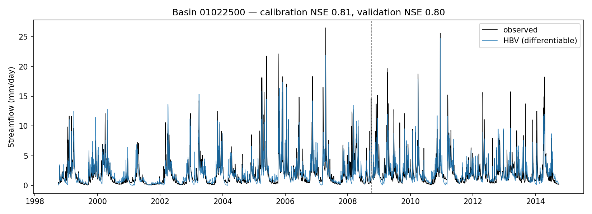

# hbv-torch

**A differentiable HBV hydrological model in PyTorch, with exact mass conservation and gradient-based calibration on CAMELS basins.**

HBV is one of the most widely used conceptual rainfall–runoff models. `hbv-torch` writes the full HBV-96 structure in PyTorch so that parameters can be learned by backpropagation instead of random search. This opens the door to hybrid models where a neural network predicts HBV parameters from catchment attributes, an approach known as differentiable parameter learning (Tsai et al., 2021; Feng et al., 2022).

- **Differentiable:** every step of the model is a PyTorch operation, so gradients of any loss reach all 15 parameters.
- **Mass-conserving:** precipitation = evapotranspiration + runoff + storage change, closed to about 10⁻¹² mm over 16 years, and checked in the tests.
- **Batched:** simulates many basins at once, ready for large-sample hydrology (CAMELS, Caravan).
- **Physically bounded:** parameters are learned in an unconstrained space and mapped to published ranges with a sigmoid.

## Model structure

```
 precipitation, temperature                     PET
          │                                       │
   ┌──────▼──────┐  melt / rain   ┌──────────────▼─────┐  recharge  ┌────────────────────┐
   │ Snow routine│───────────────▶│   Soil moisture    │───────────▶│ Upper zone (SUZ)   │──▶ Q0 (above UZL), Q1
   │ degree-day  │                │ (FC, LP, BETA)      │            └─────────┬──────────┘
   └─────────────┘                └────────────────────┘                     │ PERC
                                                                    ┌─────────▼──────────┐
                                                                    │ Lower zone (SLZ)   │──▶ Q2 (baseflow)
                                                                    └────────────────────┘
                                         Q0 + Q1 + Q2 ──▶ triangular routing (MAXBAS) ──▶ Q outlet
```

| Routine | Parameters | Equations |
|---|---|---|
| Snow | TT, CFMAX, SFCF, CFR, CWH | snow if T < TT; melt = CFMAX·(T − TT); refreeze = CFR·CFMAX·(TT − T); snowpack holds CWH·snow of liquid water |
| Soil | FC, LP, BETA | recharge = input·(SM/FC)^BETA; ET = PET·min(SM/(LP·FC), 1) |
| Response | PERC, UZL, K0, K1, K2 | Q0 = K0·max(SUZ − UZL, 0); Q1 = K1·SUZ; Q2 = K2·SLZ; percolation ≤ PERC |
| Routing | MAXBAS | triangular unit hydrograph with base MAXBAS days |
| Input | PCORR | rainfall correction factor |

Parameter ranges are listed in [`hbv_torch/model.py`](hbv_torch/model.py). Potential evapotranspiration is computed with the Hargreaves method (FAO-56 extraterrestrial radiation).

## Quick start

```bash
git clone https://github.com/charouk/hbv-torch.git
cd hbv-torch
pip install -e .
pytest                       # mass balance, gradients, synthetic parameter recovery
```

Download the **CAMELS time series** from [NCAR](https://ral.ucar.edu/solutions/products/camels) and unzip it so that `basin_mean_forcing/` and `usgs_streamflow/` sit in one folder. Then calibrate one basin:

```bash
python -m hbv_torch.calibrate --camels-root path/to/CAMELS --basin 01022500 --epochs 300
```

This trains on water years 2000–2008 (after a one-year warm-up), validates on 2009–2014, and writes `params.json`, `metrics.json`, `simulation.csv`, `hydrograph.png` and `training_curve.png` to `results/<basin>/`. One basin takes about 15 minutes on a laptop CPU.

Use it from Python:

```python
import torch
from hbv_torch import HBV, nse_loss

model = HBV(n_basins=1)
out = model(precip, temp, pet)          # tensors of shape [basins, days]
loss = nse_loss(qobs, out.q_routed)
loss.backward()                         # gradients for all 15 parameters
print(out.water_balance_residual())     # ~0
```

## Results

<!-- Replace this section with your own runs. -->

| Basin | Calibration NSE | Validation NSE | Validation KGE | Water-balance residual |
|---|---|---|---|---|
| 01022500 | _to fill_ | _to fill_ | _to fill_ | _to fill_ |



## Tests

| Test | What it checks |
|---|---|
| `test_water_balance_closes` | inputs − outputs − Δstorage < 10⁻⁹ mm for random parameters |
| `test_states_non_negative` | no negative storages or fluxes |
| `test_every_parameter_gets_a_gradient` | backpropagation reaches the parameters |
| `test_calibration_recovers_synthetic_truth` | flow generated with known parameters is re-fitted with NSE > 0.9 |

## Roadmap

- [ ] Calibrate the 671 CAMELS basins in one batch and map parameters against catchment attributes
- [ ] Differentiable parameter learning: a neural network predicting HBV parameters from attributes
- [ ] Comparison with an LSTM baseline (see [hydro-ai-foundations](https://github.com/charouk/hydro-ai-foundations))
- [ ] Uncertainty: ensembles of calibrated parameter sets

## References

- Bergström, S. (1976). *Development and application of a conceptual runoff model for Scandinavian catchments*. SMHI Report RHO 7.
- Lindström, G., et al. (1997). Development and test of the distributed HBV-96 hydrological model. *Journal of Hydrology*, 201, 272–288.
- Seibert, J., & Vis, M. J. P. (2012). Teaching hydrological modeling with a user-friendly catchment-runoff-model software package. *HESS*, 16, 3315–3325.
- Newman, A. J., et al. (2015). Development of a large-sample watershed-scale hydrometeorological data set for the contiguous USA. *HESS*, 19, 209–223.
- Tsai, W.-P., et al. (2021). From calibration to parameter learning. *Nature Communications*, 12, 5988.
- Feng, D., Liu, J., Lawson, K., & Shen, C. (2022). Differentiable, learnable, regionalized process-based models with multiphysical outputs can approach state-of-the-art hydrologic prediction accuracy. *Water Resources Research*.

## Author

**Ichrak Boubakri** — hydrological forecasting and physics-informed machine learning · [GitHub](https://github.com/charouk) · ichrak.enstab@gmail.com

This is an independent open implementation built from published equations and public data. It contains no data or code from any client project.

MIT License.
